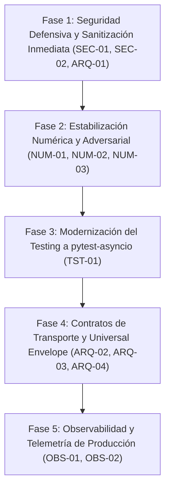

# INFORME DE AUDITORÍA TÉCNICA INTEGRAL Y ARQUITECTURA
**Proyecto:** InvestAI — Plataforma Cuantitativa y Determinista de Gestión de Carteras  
**Fecha de Emisión:** 7 de Octubre de 2026  
**Alcance:** Totalidad de la base de código en `backend/` (dominio, modelos, servicios numéricos, routers y suite de 137 tests)  
**Modalidad:** Auditoría Técnica y Diagnóstico Integral (Lectura Estricta)  
**Estándares y Marcos de Referencia Aplicados:**
- `adversarial-code-auditor`: Modelado de amenazas cuantitativas, robustez numérica y casos extremos de álgebra lineal.
- `api-contract-fastapi`: Clean Architecture, Universal Envelope, desacoplamiento de capas y contratos DTO.
- `secure-coding-hardened-systems`: Validación defensiva, inmutabilidad Pydantic v2, mitigaciones OWASP y gestión de errores.
- `pytest-async-testsuite`: Cobertura, aislamiento de pruebas, ciclo de vida asíncrono y control de fugas de recursos.
- `observability-metrics-tracing`: Trazabilidad distribuida (OTel), métricas RED, correlación y logging estructurado.

---

## RESUMEN EJECUTIVO

InvestAI presenta una **base matemática, cuantitativa y de dominio de notable solidez**, destacándose por la implementación determinista de reglas de concentración y valoración, contracción de covarianza de Ledoit-Wolf, máquina de estados finitos (FSM) estricta para el ciclo de vida de órdenes y un motor de fricciones de mercado con desglose detallado de aranceles, comisiones e IVA.

Sin embargo, la auditoría identificó **vulnerabilidades de seguridad críticas en transporte**, **puntos de inestabilidad matemática en optimización ante activos de varianza nula**, **omisión del estándar de validación defensiva en Pydantic v2 (`extra="forbid"`)**, **deuda técnica estructural en la suite de pruebas (100% dependiente de `unittest` sin migración a `pytest-asyncio`)** y **ausencia total de instrumentación de observabilidad**.

A continuación se detalla el diagnóstico exhaustivo dividido en 5 dimensiones técnicas.

---

## 1. ESTADO DE CUMPLIMIENTO ARQUITECTÓNICO

### 1.1 Desacoplamiento de Capas (Domain vs. Service vs. Transport)
* **Fuga de Lógica de Dominio a la Capa de Transporte (`Transport Leaks`):**
  * En [`backend/app/api/v1/endpoints/backtest.py`](file:///c:/Users/risso/Desktop/InvestAI_Mattia_Risso/backend/app/api/v1/endpoints/backtest.py#L12-L86), la función estocástica `_generate_gbm_market_prices` (simulación de trayectorias con Movimiento Browniano Geométrico, SDE de Black-Scholes y calibración de volatilidades empíricas) está codificada **directamente dentro del controlador de rutas**.
  * En [`backend/app/api/v1/endpoints/optimization.py`](file:///c:/Users/risso/Desktop/InvestAI_Mattia_Risso/backend/app/api/v1/endpoints/optimization.py#L35-L167), tanto `_generate_synthetic_returns` como `_prepare_quantitative_inputs` residen dentro del archivo de endpoints. La capa de transporte asume responsabilidades de síntesis y preparación de matrices financieras que pertenecen a servicios de aplicación o dominio.
* **Inexistencia de Repositorios y Unit of Work (UoW):**
  * Los endpoints dependen directamente de `db: AsyncSession` inyectado mediante dependencias de FastAPI ([`backend/app/api/deps.py`](file:///c:/Users/risso/Desktop/InvestAI_Mattia_Risso/backend/app/api/deps.py)). Las consultas, inserciones y mutaciones (`db.execute()`, `db.add()`, `db.flush()`) se orquestan directamente en los controladores HTTP.
  * La falta de una unidad transaccional (`UnitOfWork`) impide garantizar atomicidad desacoplada de la infraestructura HTTP; si una operación compuesta falla a mitad de camino, la reversión depende exclusivamente del context manager de la sesión de base de datos.
* **Bypass de Entidades de Dominio en Servicios:**
  * En [`backend/app/services/portfolio_service.py`](file:///c:/Users/risso/Desktop/InvestAI_Mattia_Risso/backend/app/services/portfolio_service.py#L132-L212), la función `build_portfolio_response` mapea directamente de `PortfolioModel` (entidad ORM de SQLAlchemy) a `PortfolioResponse` (DTO Pydantic), puenteando por completo la entidad de dominio `Portfolio` ([`backend/app/domain/models/portfolio.py`](file:///c:/Users/risso/Desktop/InvestAI_Mattia_Risso/backend/app/domain/models/portfolio.py)). La capa de persistencia se acopla directamente con la de presentación.

### 1.2 Patrón Universal Envelope (`api-contract-fastapi`)
* **Ausencia de Envoltorio Estándar:**
  * El 100% de los endpoints retorna modelos desnudos o diccionarios (`PortfolioResponse`, `OptimizationResult`, `BacktestResult`).
  * No se implementa la envoltura canónica tipada:
    ```python
    APIResponse[T](data=..., meta=ResponseMeta(request_id=..., timestamp=..., trace_id=...))
    ```
* **Contratos de Error Inconsistentes:**
  * Las rutas lanzan directamente `HTTPException(status_code=..., detail=...)`.
  * El manejador global en [`backend/app/main.py`](file:///c:/Users/risso/Desktop/InvestAI_Mattia_Risso/backend/app/main.py#L47-L70) devuelve estructuras dispares: `{"error_type": "VALIDATION_ERROR", "message": "...", "details": ...}` para validaciones y `{"error_type": "INTERNAL_SERVER_ERROR", "detail": ...}` para errores 500, sin un `APIErrorResponse` estructurado y tipado.
* **Contratos REST Avanzados Faltantes:**
  * No existe paginación por cursor validada por HMAC para listados de carteras o históricos de órdenes.
  * No se implementan encabezados de idempotencia (`Idempotency-Key`) respaldados por Redis para endpoints de mutación crítica (rebalanceo, backtesting).

### 1.3 Validación Defensiva con Pydantic v2 (`secure-coding-hardened-systems`)
* **Omisión Sistemática de `extra="forbid"`:**
  * En todos los esquemas de entrada y mutación ([`portfolio.py`](file:///c:/Users/risso/Desktop/InvestAI_Mattia_Risso/backend/app/schemas/portfolio.py), [`optimization.py`](file:///c:/Users/risso/Desktop/InvestAI_Mattia_Risso/backend/app/schemas/optimization.py), [`backtest.py`](file:///c:/Users/risso/Desktop/InvestAI_Mattia_Risso/backend/app/schemas/backtest.py)), `model_config` omite `extra="forbid"`.
  * Al aplicar Pydantic v2 por defecto `extra="ignore"`, la API descarta silenciosamente parámetros no reconocidos. Esto expone a la aplicación a ataques de *mass-assignment* y oculta errores de tipeo del cliente en peticiones críticas.
* **Inmutabilidad Incompleta:**
  * `TailRiskMetrics`, `BacktestPerformanceMetrics` y `BacktestResult` configuran `frozen=True`. Sin embargo, los esquemas de entidad de cartera, tenencias y órdenes permanecen mutables (`frozen=False`), habilitando alteraciones colaterales de estado en capas intermedias.

---

## 2. AUDITORÍA NUMÉRICA Y ADVERSARIAL (FINANZAS CUANTITATIVAS)

### 2.1 Vulnerabilidad y Fragilidad Matemática en Álgebra Lineal

#### A. Contracción de Covarianza (Ledoit-Wolf)
* **Comportamiento ante Series Discontinuas (`NaN` / `Inf`):**
  * En [`backend/app/domain/services/quantitative_risk.py`](file:///c:/Users/risso/Desktop/InvestAI_Mattia_Risso/backend/app/domain/services/quantitative_risk.py#L21-L24), `ledoit_wolf_covariance` aborta con `ValueError` ante cualquier presencia de `NaN` o `Inf`. No existe un protocolo de imputación previa ni alineación temporal robusta, provocando fallas duras 400/500 en la API ante baches de mercado.
* **Activos con Varianza Nula (Series Constantes):**
  * Si un activo se mantiene plano o suspendido, su varianza muestral es 0. Si toda la matriz presenta varianza nula, la distancia de Frobenius al target $d^2 = ||S - F||_F^2$ colapsa a 0, derivando en indeterminaciones en el cálculo de la intensidad óptima $\delta^*$.

#### B. Descomposición de Cholesky y Regularización Espectral
* **Acierto de Diseño:**
  * `safe_cholesky` ([`backend/app/domain/services/numerical_stability.py`](file:///c:/Users/risso/Desktop/InvestAI_Mattia_Risso/backend/app/domain/services/numerical_stability.py#L5-L79)) implementa simetrización explícita, escalamiento progresivo de jitter diagonal ($10^{-6} \to 10^{-2}$) y proyección espectral de Higham (recorte de autovalores negativos) ante matrices singulares.
* **Punto Ciego en Funciones Auxiliares:**
  * `nearest_positive_definite` ([L123-L142](file:///c:/Users/risso/Desktop/InvestAI_Mattia_Risso/backend/app/domain/services/numerical_stability.py#L123-L142)) y `matrix_condition_number` ([L144-L160](file:///c:/Users/risso/Desktop/InvestAI_Mattia_Risso/backend/app/domain/services/numerical_stability.py#L144-L160)) **no validan `NaN` ni `Inf`**. Si reciben una matriz corrupta, `np.linalg.eigh` o `np.linalg.svd` arrojan excepciones no controladas.

#### C. Optimización de Mínima Varianza (SLSQP)
* **Bypass de Validación ante No-Convergencia:**
  * En [`backend/app/domain/services/portfolio_optimizer.py`](file:///c:/Users/risso/Desktop/InvestAI_Mattia_Risso/backend/app/domain/services/portfolio_optimizer.py#L55):
    ```python
    if not result.success and result.x is None:
        raise RuntimeError(f"La optimización de mínima varianza no convergió: {result.message}")
    ```
    Si el solver SLSQP no converge pero `result.x` contiene un array (por ejemplo, con valores `NaN` o fuera de cotas por matrices mal condicionadas), la condición evalúa a `False`. El código ejecuta `raw_weights = np.maximum(0.0, result.x)` sin validar `np.isnan(result.x).any()`, propagando `NaN` al resultado y eludiendo el fallback seguro de equiponderación (`w0`).

#### D. Paridad de Riesgo / Equal Risk Contribution (L-BFGS-B & Formulación de Spinu)
* **Vulnerabilidad Crítica ante Activos de Varianza Cero:**
  * En [`backend/app/domain/services/portfolio_optimizer.py`](file:///c:/Users/risso/Desktop/InvestAI_Mattia_Risso/backend/app/domain/services/portfolio_optimizer.py#L108):
    ```python
    y0 = 1.0 / np.sqrt(np.maximum(variances, 1e-8))
    ```
    Si un activo tiene varianza 0 (ej. efectivo sin remunerar), su estimación inicial $y_0$ se fija en $10.000$. En el gradiente analítico:
    $$\nabla f(y) = \Sigma y - \frac{1}{y}$$
    Para el activo sin volatilidad, $(\Sigma y)_i = 0$, resultando en un gradiente estrictamente negativo ($-\frac{1}{y} < 0$). El optimizador empujará $y_i$ hacia infinito para minimizar el término de barrera $-\ln(y_i)$, canibalizando las ponderaciones del resto de los activos.
* **Mismo Bypass de Fallback en L-BFGS-B:**
  * Si `result.success` es falso pero `result.x` no es `None` ([L129](file:///c:/Users/risso/Desktop/InvestAI_Mattia_Risso/backend/app/domain/services/portfolio_optimizer.py#L129)), no se activa el fallback a volatilidad inversa, propagando estados inestables.

---

### 2.2 Resiliencia del Motor de Backtest y FSM de Órdenes

#### A. Sincronización Temporal Asíncrona (Intersección de Fechas)
* En [`backend/app/domain/services/backtest_engine.py`](file:///c:/Users/risso/Desktop/InvestAI_Mattia_Risso/backend/app/domain/services/backtest_engine.py#L249):
  ```python
  common_dates = set.intersection(*[set(price_history[t].keys()) for t in tickers])
  ```
  Si el universo de inversión incluye un activo recién listado (ej. 10 días de historia) junto con activos consolidados (500 días), la intersección contrae la ventana común a solo 10 ruedas. Al cumplirse `len(sorted_dates) < min_observations` (15), **toda la cartera se degrada a equiponderación ($1/N$)**, anulando la optimización para todo el conjunto de activos maduros.

#### B. Costos de Fricción Superiores al Monto Operado (Penny Stocks / Ventas Forzosas)
* En [`backend/app/domain/services/market_frictions.py`](file:///c:/Users/risso/Desktop/InvestAI_Mattia_Risso/backend/app/domain/services/market_frictions.py#L190):
  ```python
  net_total = round(effective_amount - (alyc_comm + alyc_vat + market_fees), 4)
  ```
  Si una posición residual en liquidación tiene un valor inferior a la comisión mínima fija del broker (`min_fee`), `net_total` resulta **negativo**.
* En [`backend/app/domain/services/backtest_engine.py`](file:///c:/Users/risso/Desktop/InvestAI_Mattia_Risso/backend/app/domain/services/backtest_engine.py#L359):
  ```python
  cash += breakdown.net_total_amount
  ```
  La venta de títulos resta efectivo en lugar de sumar liquidez. Si la caja disponible es reducida, el saldo de efectivo se vuelve negativo sin contar con validaciones de margen ni financiamiento explícito.

#### C. Determinismo de la FSM de Órdenes
* El modelo [`backend/app/domain/models/order.py`](file:///c:/Users/risso/Desktop/InvestAI_Mattia_Risso/backend/app/domain/models/order.py#L39-L46) implementa transiciones formalmente correctas y exhaustivas (`CREATED -> VALIDATED -> SUBMITTED -> FILLED / REJECTED`).
* Sin embargo, el motor de backtest asume que todas las órdenes son de tipo `MARKET` y se completan íntegramente al 100% en el día (`filled_quantity = quantity`), sin modelar órdenes límite no ejecutadas (*unfilled / partial fills*) ni deslizamientos asimétricos ante falta de contraparte.

---

## 3. EVALUACIÓN DE LA SUITE DE TESTING

### 3.1 Transición hacia `pytest-asyncio`
* **Dependencia Total de `unittest`:**
  * Las **137 pruebas actuales** están construidas sobre la biblioteca estándar `unittest` (`unittest.TestCase` y `unittest.IsolatedAsyncioTestCase`).
  * No hay configuración de `pytest` en el entorno: no existe `pytest.ini`, `pyproject.toml` para pruebas ni archivo `conftest.py`.
  * La ejecución se realiza exclusivamente vía `python -m unittest discover -s tests -t .` dentro de `backend/`.
* **Fuga de Recursos en Conexiones SQLite:**
  * Al ejecutar los tests de integración ([`backend/tests/integration/test_api_endpoints.py`](file:///c:/Users/risso/Desktop/InvestAI_Mattia_Risso/backend/tests/integration/test_api_endpoints.py)), el motor emite advertencias de recursos:
    ```text
    ResourceWarning: unclosed database in <sqlite3.Connection object at 0x...>
    ```
    Esto ocurre porque cada clase crea y destruye su propio motor asíncrono en `asyncSetUp` y sobreescribe dependencias sin asegurar el drenaje del pool de conexiones tras cada caso de prueba.
* **Advertencias de Deprecación de Starlette:**
  * Uso de códigos de estado obsoletos (`HTTP_422_UNPROCESSABLE_ENTITY` en lugar de `HTTP_422_UNPROCESSABLE_CONTENT`).
  * `StarletteDeprecationWarning: Using httpx with starlette.testclient is deprecated; install httpx2 instead.`

### 3.2 Puntos Ciegos de Cobertura en las 137 Pruebas
1. **Ausencia de Pruebas de Estrés con Matrices Hostiles:**
   * No existen tests unitarios que desafíen a `portfolio_optimizer.py` o `quantitative_risk.py` con matrices de correlación perfecta ($1.0$), matrices de rango deficiente ($N > T$), ni matrices con autovalores negativos severos.
2. **Inexistencia de Pruebas Basadas en Propiedades (*Property-Based Testing*):**
   * No se utiliza `Hypothesis` para verificar invariantes fundamentales (ej. que la suma de ponderaciones de la cartera sea idénticamente $1.000000 \pm 10^{-6}$ bajo cualquier distribución estocástica de retornos).
3. **Cero Concurrencia y Detección de Condiciones de Carrera:**
   * No se prueba la ejecución concurrente (`asyncio.gather`) de rebalanceos o modificaciones de cartera sobre un mismo `portfolio_id` para evaluar bloqueos de base de datos o colisiones en la FSM.
4. **Falta de Validación de Payloads con Campos Extra:**
   * No existen casos de prueba que envíen campos no declarados para verificar el rechazo estricto de entradas maliciosas (`extra="forbid"`).

---

## 4. OBSERVABILIDAD, TELEMETRÍA Y SEGURIDAD OPERATIVA

### 4.1 Instrumentación y Telemetría (`observability-metrics-tracing`)
* **Ausencia de OpenTelemetry (OTel):**
  * La aplicación carece de SDK de OpenTelemetry, trazabilidad distribuida (W3C TraceContext) y propagación de `trace_id` en peticiones entrantes y salientes.
* **Cero Logging Estructurado:**
  * El único archivo del proyecto que instancia un logger es [`backend/app/core/config.py`](file:///c:/Users/risso/Desktop/InvestAI_Mattia_Risso/backend/app/core/config.py).
  * Ni los routers HTTP ni los motores matemáticos emiten logs en formato JSON estructurado. El sistema opera en silencio diagnóstico ante fallos en producción.
* **Health Probes Deficientes (Liveness vs. Readiness):**
  * El endpoint `/health` ([`backend/app/main.py`](file:///c:/Users/risso/Desktop/InvestAI_Mattia_Risso/backend/app/main.py#L86-L93)) devuelve un JSON estático `{"status": "healthy"}` sin verificar la conectividad real con la base de datos (SELECT 1). No califica como *readiness probe* para orquestadores de contenedores (Kubernetes/Docker Swarm).

### 4.2 Hallazgos Críticos de Seguridad (`secure-coding-hardened-systems`)
1. **Configuración de CORS Vulnerable:**
   * En [`backend/app/main.py`](file:///c:/Users/risso/Desktop/InvestAI_Mattia_Risso/backend/app/main.py#L38-L44):
     ```python
     app.add_middleware(
         CORSMiddleware,
         allow_origins=["http://localhost:5173", "http://127.0.0.1:5173", "*"],
         allow_credentials=True,
         allow_methods=["*"],
         allow_headers=["*"],
     )
     ```
     Combinar `allow_origins=["*"]` con `allow_credentials=True` es una **vulnerabilidad crítica de seguridad**. En la especificación CORS estándar, los navegadores rechazan credenciales con comodín, o bien los frameworks reflejan el origen del atacante, posibilitando ataques de CSRF autenticados.
2. **Fuga de Información en Manejador de Errores 500:**
   * En [`backend/app/main.py`](file:///c:/Users/risso/Desktop/InvestAI_Mattia_Risso/backend/app/main.py#L68), `global_exception_handler` devuelve `"detail": str(exc)`. En producción, esto filtra detalles de implementación interna, rutas del sistema y trazas de base de datos a clientes no autenticados.
3. **Divulgación de Infraestructura en `/`:**
   * En [`backend/app/main.py`](file:///c:/Users/risso/Desktop/InvestAI_Mattia_Risso/backend/app/main.py#L80), el endpoint raíz expone públicamente el host y nombre de la base de datos: `settings.ASYNC_DATABASE_URI.split("@")[-1]`.
4. **Mecanismo de Autenticación Mock Suceptible a Suplantación (BOLA/IDOR):**
   * En [`backend/app/api/deps.py`](file:///c:/Users/risso/Desktop/InvestAI_Mattia_Risso/backend/app/api/deps.py#L23-L48), `get_current_user` adopta ciegamente el valor del encabezado `X-User-Id`. Cualquier cliente puede impersonar a cualquier usuario o forzar la creación de usuarios arbitrarios en la base de datos con contraseñas mock.

---

## 5. MATRIZ DE RECOMENDACIONES PRIORIZADAS

| ID | Componente | Hallazgo / Brecha Técnica | Severidad | Skill Asociada | Impacto Estimado |
| :--- | :--- | :--- | :---: | :--- | :--- |
| **SEC-01** | `app/main.py` | CORS con `allow_origins=["*"]` y `allow_credentials=True`. | **ALTA** | `secure-coding-hardened-systems` | Crítico: Exposición a CSRF y denegación de credenciales en navegadores. |
| **SEC-02** | `app/main.py` | Fuga de trazas de excepción (`str(exc)`) en errores 500 y URI de DB en `/`. | **ALTA** | `secure-coding-hardened-systems` | Alto: Divulgación de arquitectura interna e infraestructura. |
| **SEC-03** | `app/api/deps.py` | Autenticación mock basada en encabezado arbitrario `X-User-Id` sin firma criptográfica. | **ALTA** | `secure-coding-hardened-systems` | Crítico: Riesgo de IDOR/BOLA absoluto previo al paso a producción. |
| **NUM-01** | `services/portfolio_optimizer.py` | Risk Parity diverge o canibaliza pesos ante activos con varianza cero ($\sigma^2=0$). | **ALTA** | `adversarial-code-auditor` | Crítico: Pesos infinitos o NaN ante activos planos / caja en optimización. |
| **NUM-02** | `services/portfolio_optimizer.py` | SLSQP y L-BFGS-B no validan `NaN` en `result.x` cuando el solver falla con array no nulo. | **ALTA** | `adversarial-code-auditor` | Alto: Retorno de ponderaciones corruptas sin activar los fallbacks de contingencia. |
| **ARQ-01** | `app/schemas/` | Ausencia de `extra="forbid"` en todos los esquemas de entrada de Pydantic v2. | **ALTA** | `secure-coding-hardened-systems` | Medio-Alto: Admisión de parámetros ilegítimos o errores tipográficos desapercibidos. |
| **ARQ-02** | `api/v1/endpoints/` | Ausencia total del patrón Universal Envelope (`APIResponse` / `APIErrorResponse`). | **MEDIA** | `api-contract-fastapi` | Alto: Inconsistencia contractual con frontend y clientes externos. |
| **ARQ-03** | `endpoints/backtest.py` / `optimization.py` | Fuga de lógica matemática y generación sintética dentro de los controladores HTTP. | **MEDIA** | `api-contract-fastapi` | Medio: Violación de Clean Architecture; acoplamiento entre transporte y dominio. |
| **ARQ-04** | `app/services/` | Inexistencia del patrón Unit of Work y Repositorios formales (`AsyncSession` directo). | **MEDIA** | `api-contract-fastapi` | Medio: Dificultad para coordinar transacciones atómicas complejas y testing desacoplado. |
| **NUM-03** | `services/backtest_engine.py` | Intersección estricta de fechas degrada a toda la cartera a $1/N$ si un solo activo es nuevo. | **MEDIA** | `adversarial-code-auditor` | Medio-Alto: Resultados de backtest distorsionados en universos heterogéneos. |
| **NUM-04** | `market_frictions.py` / `backtest_engine.py` | Ventas en iliquidez con comisiones mínimas superiores al trade drenan efectivo. | **MEDIA** | `adversarial-code-auditor` | Medio: Posible saldo negativo de caja no respaldado por apalancamiento formal. |
| **TST-01** | `backend/tests/` | Suite 100% ligada a `unittest`; sin `pytest`, sin `conftest.py` y con fugas de SQLite. | **MEDIA** | `pytest-async-testsuite` | Alto: Deuda técnica en testing moderno asíncrono y lentitud de parametrización. |
| **OBS-01** | `backend/app/` | Cero instrumentación de OpenTelemetry, sin trace IDs y sin logging estructurado. | **MEDIA** | `observability-metrics-tracing` | Alto: Ceguera operativa total ante incidentes de producción. |
| **OBS-02** | `app/main.py` | `/health` es un mock estático que no prueba conectividad real con la base de datos. | **BAJA** | `observability-metrics-tracing` | Medio: Falsos positivos en *readiness probes* de orquestadores de contenedores. |
| **ARQ-05** | `app/schemas/` | DTOs mutables sin `frozen=True` en modelos de entidad de cartera y órdenes. | **BAJA** | `secure-coding-hardened-systems` | Bajo: Riesgo de efectos secundarios por mutación accidental en memoria. |

---

## 6. PLAN DE ACCIÓN Y HOJA DE RUTA SUGERIDA

Para abordar los hallazgos de forma metódica sin introducir regresiones en los 137 tests funcionales aprobados, se propone el siguiente orden de fases:



1. **Fase 1: Seguridad Defensiva y Sanitización Inmediata (`SEC-01`, `SEC-02`, `ARQ-01`):**
   - Corregir CORS eliminando `*` cuando `allow_credentials=True`.
   - Ocultar trazas internas en excepciones 500 y remover URI de la base de datos en `/`.
   - Añadir `extra="forbid"` en todos los esquemas Pydantic v2.
2. **Fase 2: Estabilización Numérica y Adversarial (`NUM-01`, `NUM-02`, `NUM-03`, `NUM-04`):**
   - Blindar el optimizador de Risk Parity separando explícitamente activos de varianza cero (caja) y asegurando que las fallas del solver activen el fallback de volatilidad inversa sin propagar `NaN`.
   - Flexibilizar la ventana de cálculo en el motor de backtesting para evitar que activos de reciente cotización degraden toda la cartera a equiponderación.
3. **Fase 3: Modernización de la Suite de Testing (`TST-01`):**
   - Configurar `pytest` y `pytest-asyncio` formalmente con un archivo `conftest.py` y fixtures de base de datos aisladas mediante savepoints transaccionales (eliminando fugas de memoria en SQLite).
   - Añadir pruebas de propiedades (`Hypothesis`) para invariantes numéricas.
4. **Fase 4: Contratos de Transporte y Universal Envelope (`ARQ-02`, `ARQ-03`, `ARQ-04`):**
   - Extraer generadores estocásticos (`_generate_gbm_market_prices`, `_generate_synthetic_returns`) de los routers hacia servicios de aplicación/dominio.
   - Implementar el patrón `APIResponse[T]` / `APIErrorResponse` estandarizado.
5. **Fase 5: Observabilidad de Producción (`OBS-01`, `OBS-02`):**
   - Configurar middleware de correlación (`trace_id` / `request_id`).
   - Implementar logging estructurado en JSON y convertir `/health` en una sonda de preparación (*readiness*) que verifique la conexión con la base de datos.
